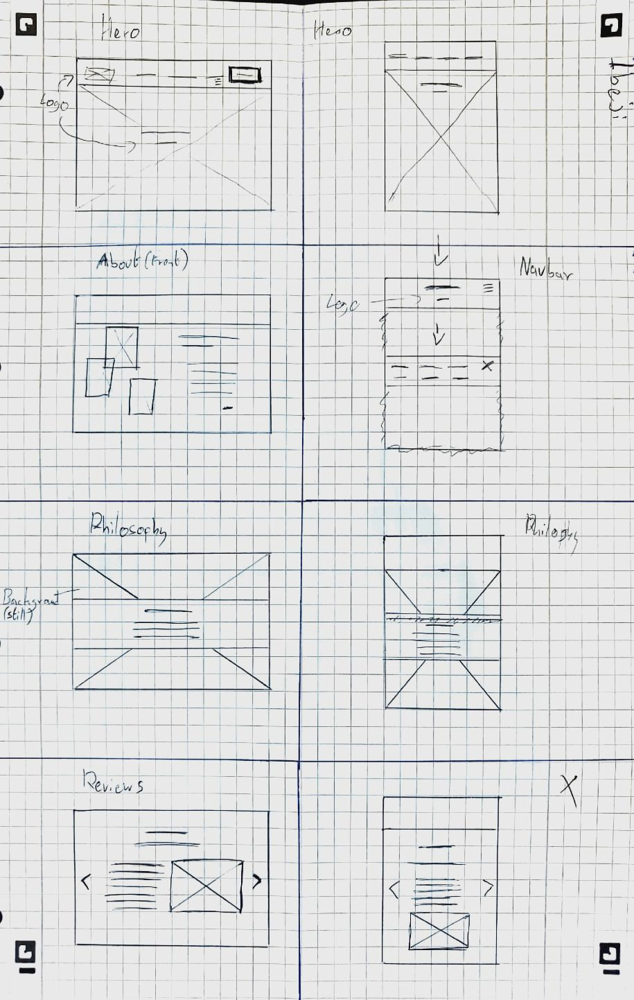
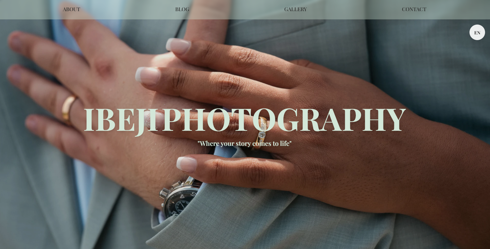
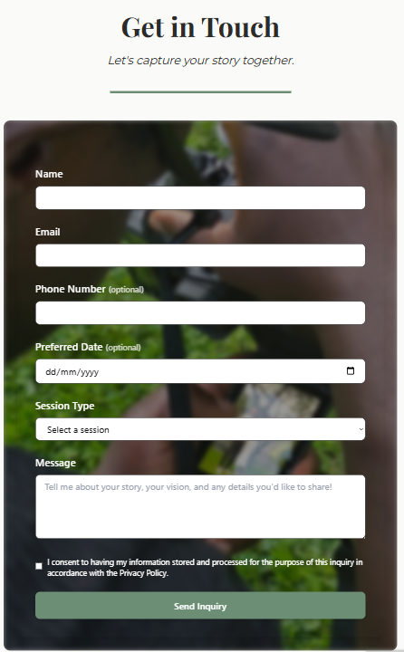

# Photography Portfolio Website

A production site for a solo photographer, built with Next.js (App Router), TypeScript and Tailwind CSS, with a headless Sanity CMS for the blog and gallery. The client edits content on their own; I run everything underneath it.

## Infrastructure

The site runs on my own VPS, managed with Coolify, using the same delivery pipeline as this portfolio.

- **Build in CI, not on the server:** GitHub Actions builds the Docker image and pushes it to GHCR. The VPS only pulls a finished image, so a deploy never competes with the other sites on the box for CPU.
- **Staging and production:** the `dev` branch deploys to a staging environment and `main` deploys to production. Changes get checked on staging before the client sees them.
- **Rollbacks:** every image is tagged with the commit it came from, so going back to the previous version means redeploying an earlier tag.
- **Reverse proxy and TLS:** Traefik routes traffic to the container and handles certificates automatically.
- **Separate CMS:** Sanity is hosted separately from the site container, so the content system and the website can be changed and restarted independently.
- **Monitoring:** the server and the site are monitored, so I find out about a problem before the client does.

## Application

The front end uses Next.js with locale-aware routing and translation helpers for multilingual content. Sanity exposes the blog and gallery through its content API, so the client can update text and images without touching code.

The contact form posts to a backend handler with reCAPTCHA, a honeypot field and rate limiting, then sends the enquiry by email. It is built with GDPR expectations in mind.

High-resolution photos go through Next.js image optimisation with remote patterns and several quality presets. Animations stick to transform and opacity so scrolling stays smooth.

## Process

I ran requirements meetings with the client first, then made Figma wireframes for the home, gallery, about, blog and contact pages and iterated on them together before writing any code. The design keeps the photography central, with generous whitespace, restrained colour and typography that fits the client's "elegant but approachable" brief.

## What I Learned

Running a client site is different from building one. Moving builds into CI, keeping a staging environment and being able to roll back made updates routine, and it meant I could look after the site without worrying about each deploy. Handling large image assets also taught me where the performance trade-offs sit.

## Visuals

**Wireframes overview**  

**Gallery / front page**  

**Contact form**  

**About me page**  

## Links

- Live site: [ibejiphotography.com](https://ibejiphotography.com)
